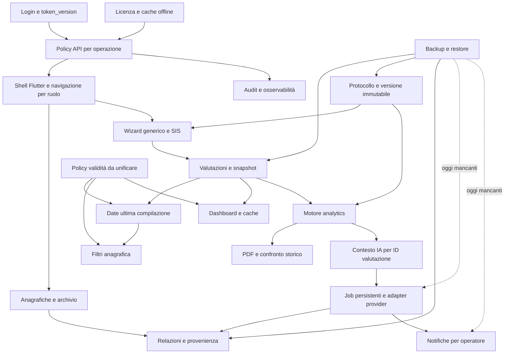

# Audit Autify — contesto progressivo

Data: 2026-10-29. Snapshot: `9dc15b5acd50167fb3f81fd8d080a2f5546f6c06`. Working tree inizialmente pulito.

## Mandato e metodo
Discovery architetturale, funzionale, sicurezza, integrità, UI e potenzialità. Unico file da modificare: questo audit; nessun deploy o modifica funzionale autorizzata da questa analisi. Le evidenze statiche non equivalgono a test in produzione. Questo documento riduce la perdita di contesto, non garantisce infallibilità.

## Vincoli
Vocabolario educativo; nomi tecnici legacy mantenuti. MongoDB `autanalysis` non va rinominato. VERSION è la fonte di versione. Consultati ARCHITECTURE_MAP.md, gemini.md e .agents/rules/regole-ingagio.md. La mappa mescola snapshot settembre con aggiornamenti 4.0.2: verificare ogni voce sul codice attuale. Nessuna memoria precedente pertinente trovata.

## Mappa iniziale
Flutter Web → Nginx /api → FastAPI (router separati) → Motor/MongoDB. Calcoli in analytics.py, PDF in pdf_generator.py; IA lato server con adapter e crittografia; licenze tramite servizio centrale esterno. Dieci collection: patients, evaluations, users, scales, settings, ai_analyses, ai_jobs, notifications, audit_logs, licenses.

## Registro progressivo
- Letti inventario, architettura, auth.py, main.py, database.py, routers/_helpers.py, routers/auth.py, routers/backup.py, conftest.py, requirements, Compose e Nginx.
- Correzioni rispetto al vecchio assessment: client router autenticati; export/import DB admin-only; token_version controllata sul DB e incrementata su modifiche credenziali/ruoli; backup AES-GCM; prevalidazione strutturale import presente.
- DATA-01 attuale: backup omette ai_jobs e notifications. Import salta collection vuote; delete_many precede insert_many senza rollback. Valida dict/list, non schema, unicità o riferimenti. default=str perde tipi BSON. Export illimitato ma import massimo 5 MiB. Cifratura dipende da JWT_SECRET_KEY; pianificare conservazione/rotazione chiavi. Versione export cercata in backend/VERSION, da verificare rispetto Dockerfile.
- SEC-01 attuale: bootstrap fallback admin/admin; must_change_password restituito da login ma non imposto da verify_auth. Compose non passa INITIAL_ADMIN_PASSWORD. Verificare flusso UI.
- OPS-01: CORS non include PATCH; verificare utilizzo settings/ai cross-origin. Mongo non pubblica porta host ma non ha autenticazione nel Compose. Nginx non inoltra X-Forwarded-For; rate limit per IP da verificare nel deployment reale.

## Prossimo punto di ripresa
Leggere router IA/licenze, CRUD e motore calcolo; UI/contratti API; documenti remediation/redesign; eseguire suite isolata se disponibile; completare registro con priorità, evidenze e criteri di accettazione.

## Checkpoint 2 — flussi e verifiche
- Suite backend eseguita con Python 3.11 isolato via uv, requisiti repo: **77 passed, 93 warnings**. Nessun provider/DB reale. Vecchio risultato 20/1 non rappresenta più il repository.
- Import SIS: settings.py richiama `_import_sis_scale` senza import; definita solo in evaluations.py. Riproduzione locale da completare.
- Snapshot scala salvato in create_evaluation, ignorato in analysis/PDF/aggregati/update: questi leggono scales_collection. Lo snapshot da solo non congela lo storico.
- Validazione create parziale: lista vuota e duplicati non vietati; update_evaluation non riapplica i controlli della create e non scrive audit. Delete valutazione senza audit.
- Dashboard usa 180/180/365 giorni, ricerca anagrafica 12/12/36 mesi da 30 giorni (override server), UI locale 6/12/12 mesi calendario e alert 20 giorni. Nessuna policy unica.
- Job IA persistito ma avviato con asyncio.create_task: niente recupero startup/lease, transazioni o coda durevole. Crash può lasciare pending/running; cancellazione utente non cancella job/notifiche e un job in corso può ricreare una relazione orfana.
- Viewer autorizzato a generare IA, ma POST notifiche lette bloccato dal wrapper viewer.
- Prompt IA include identità e note, usa snapshot_scala come fallback di analysis (schema non equivale a risultati), accetta dati client e riferimenti senza riconciliazione; score zero può diventare None via `or`.
- UI: dashboard classica/V4 selezionabili con preferenza locale; nuovi componenti già hanno Semantics, retry/loading, responsive e avviso dati troncati. Audit grafico basato sul codice, non ancora verifica visiva.
- Cifratura provider presente; SSRF verifica DNS prima della connessione ma non blocca risoluzione diversa al connect; da approfondire senza dichiarare exploit dimostrato.
- Licenze: trial 15 giorni, cache 24 ore, grace 72 ore, lifetime senza ricontrollo automatico per scelta esplicita. Il gate licenza include backup e letture; valutare recupero dati a licenza scaduta.
- Bootstrap: dialog UI cambio password presente, enforcement backend assente. Token viene salvato prima del dialog.
- Analisi statica Flutter avviata, risultato pendente.

# Esito consolidato della discovery

## Valutazione complessiva
Autify è una piattaforma on-premise per una struttura educativa: anagrafiche, protocolli, compilazione guidata, confronto e storico, copertura documentale/scadenze, relazioni IA e PDF, operatori, audit, backup e licenze. Lo stack è adeguato; non emerge una necessità di riscrittura. Il rischio principale è la **coerenza fra moduli**: alcune correzioni esistono solo in un punto del flusso (snapshot salvato ma non usato; viewer IA ammesso ma bloccato dal payload UI; job persistito ma non recuperabile).

Snapshot inventariato: **165 file versionati, 53 Python, 49 Dart, 52 route applicative esplicite**, incluse health ed escluse route automatiche docs/OpenAPI. Versioni VERSION/API/pubspec/app_version/Compose allineate a **4.0.2**. La cartella locale license_server non contiene file tracciati da questo repository; il servizio centrale esterno non è stato analizzato.

## Interconnessioni da preservare

Il diagramma include la policy di validità e la versione immutabile come contratti da completare, non come servizi già centralizzati.

## Copertura effettiva

| Area | File / punti analizzati | Profondità e limite |
|---|---|---|
| Documentazione | ARCHITECTURE_MAP, REMEDIATION, CHANGELOG, LICENSE_OPERATIONS, AUTIFY_DASHBOARD_4_REDESIGN, gemini, regola .agents | Architettura letta; registro precedente confrontato con codice; changelog e procedure esaminati nelle parti pertinenti |
| Runtime | Compose, entrambi Dockerfile, nginx.conf, main.py, database.py, config.dart, versioni | Lettura statica; nessun container avviato/deploy |
| Identità | auth.py, routers/auth.py, _helpers.py, login_screen, main, api_service | Flusso login/token/revoca e viewer tracciato; no autenticazione reale |
| Dominio | models.py, routers/patients.py, evaluations.py, settings.py, misc.py, dashboard.py | CRUD, import, filtri, limiti, calcoli a valle e autorizzazioni |
| Calcoli/PDF | analytics.py, pdf_generator.py, file scale inventariati | Funzioni e conversioni principali, snapshot e costruzione PDF; nessuna certificazione delle tabelle e nessun rendering PDF |
| IA | routers/ai.py, ai/models.py, crypto.py, ssrf.py, adapter base/compatible, factory e altri adapter coperti dalla suite | Lettura flusso completo, controlli locali; nessuna chiamata a provider |
| Licenze | license_service.py, routers/license.py, UI/API licenze e test | Cache, trial/lifetime/gate, effetti su operazioni; centrale non interrogato |
| UI | main, tema, responsive_helper, dashboard selector/V4/componenti, modelli e servizi, multidimensional_dashboard, login | Lettura approfondita shell/dashboard/IA; wizard e schermate rimanenti esplorati per collegamenti e pattern, non ogni riga |
| Qualità | backend/tests, test_sis, frontend/test, script root | Suite backend, analisi statica Flutter, widget test selezionati, parsing Python versionato |

## Registro prioritizzato delle criticità

ID locali `ASTRA-*` indipendenti dal vecchio registro. **P1** = prima di considerare affidabili i flussi interessati; **P2** = consolidamento e riduzione rischio; **P3** = evoluzione. `Riprodotto` significa prova sintetica locale, mai produzione. Nessuna vulnerabilità remota è dichiarata dimostrata senza prova.

| ID / priorità | Evidenza e conseguenza | Intervento e criterio di chiusura |
|---|---|---|
| ASTRA-01 / P1 — Import SIS | **Riprodotto**: routers/settings.py:121 richiama `_import_sis_scale` senza import; funzione in evaluations.py:54. NameError sul ramo SIS. | Estrarre importer condiviso o importare correttamente; test HTTP con JSON SIS reale del repo, verificando sezioni/metadati e rollback su input invalido. |
| ASTRA-02 / P1 — Restore distruttivo | **Riprodotto con mock**: backup.py:113 cancella prima di insert fallibile. Verifica solo list/dict, non unicità, schema o riferimenti. Collection vuote saltate: vecchi dati restano. | Formato versionato, validazione preventiva completa, staging/rollback o transazioni con runtime compatibile; prova di errore a metà restore lascia DB originale integro; vuoto ripristinato come vuoto. |
| ASTRA-03 / P1 — Backup incompleto/non portabile | **Statico**: database.py ha 10 collection; mapping backup ne ha 8, mancano ai_jobs e notifications. `default=str` perde tipi, `_id` rimosso; export senza limite/import 5 MiB; chiave AES legata al JWT. VERSION cercato in backend/VERSION e non copiato in immagine. | Registro collection unico, codec tipi, gestione dimensioni coerente, backup consistente e versione esplicita; round-trip con date, job, notifiche, restore su istanza nuova e chiavi conservate. Decidere semantica licenza/instance_id nel clone. |
| ASTRA-04 / P1 — Storico instabile | **Statico**: evaluations.py:450 salva snapshot, ma PDF:183, analysis:236, aggregati:263 e update:308 leggono scala corrente. Delete scala può rendere storico non analizzabile. | Risoluzione unica snapshot/versione per tutti i lettori; legacy migrato con provenienza dichiarata. Aggiornare/eliminare una scala non deve cambiare punteggi, domande e PDF di una valutazione precedente. |
| ASTRA-05 / P1 — Validazione valutazioni | **Statico + prova motore**: create accetta risposte vuote/duplicate e non verifica completezza; update evita controlli create. SIS con un solo item per ognuno dei sei domini produce indice 68 nella prova sintetica. SIS vuota ora non produce indice: vecchio problema parzialmente corretto. | Validatore unico per scala e stato bozza/completata, unicità domande/ID valutazione, tipi/range coerenti e item necessari. Nessun indice standard su protocollo incompleto; test anche su update e compositi. |
| ASTRA-06 / P1 — Scadenze discordanti | **Statico**: dashboard 180/180/365 giorni; ricerca default 12/12/36 mesi x30, override server; UI 6/12/12 mesi calendario, warning20 contro warning30 server. Dashboard 3 scale, filtri 6. | Policy server unica con scale richieste, calendario/timezone e warning; UI visualizza risultati server. Ogni click KPI deve portare a elenco con stesso insieme e conteggio; test fine mese/anno e confini scadenza. |
| ASTRA-07 / P1 — Provenienza IA errata | **Statico lungo flusso**: multidimensional_dashboard carica analisi solo dell'ultima valutazione; api_service.dart:708 usa fallback per idScala anche per storico. Payload :748 non invia evaluation_ids, backend ai.py:456 prende solo quelli o id_valutazione: evaluations_used può risultare vuoto. | Client invia ID, backend recupera dati canonici, verifica appartenenza e calcola per ogni valutazione/snapshot; persistere ID/versione/hash input e versione prompt/modello. Due date della stessa scala devono conservare due analisi distinte. |
| ASTRA-08 / P1 — IA viewer non coerente | **Statico**: UI carica system_prompt e lo reinvia sempre; ai.py rifiuta body.system_prompt per viewer anche se uguale a quello server. **Riprodotto** wrapper _helpers blocca POST notifiche lette (403), mentre IA viewer è consentita con doppio flag. | Omettere override per viewer; capability esplicite per lettura notifiche proprie. Test UI→API viewer con flag ON/OFF e prompt custom, conservando divieto impostazioni. |
| ASTRA-09 / P1 — Affidabilità job | **Statico**: ai.py:345/434 usa create_task senza recovery startup, lease o scadenza running; relazione, stato e notifica scritti separatamente. Claim atomico evita doppio avvio normale ma non garantisce exactly-once dopo crash. | Worker durevole/claim con lease, idempotenza output, recovery, retry controllati e limiti concorrenza; simulare restart prima/dopo ogni scrittura. Non riemettere chiamate a pagamento alla cieca. |
| ASTRA-10 / P1 — Bootstrap e sessione | **Statico**: auth.py:142 default admin/admin; Compose non passa INITIAL_ADMIN_PASSWORD. must_change_password imposto solo dal dialog. Cambio password incrementa token_version, UI entra nella dashboard senza ottenere un nuovo token. | Password iniziale non prevedibile, requisito server prima di usare API, rilascio nuovo token o nuovo login dopo cambio. Test bootstrap, refresh browser prima del cambio, revoca effettiva e accesso successivo. |
| ASTRA-11 / P1 — Cancellazione e job | **Statico**: delete_patient cancella valutazioni/relazioni ma non job/notifiche; worker può scrivere una nuova relazione dopo cancellazione. Operazioni a cascata non atomiche. | Archiviazione come flusso ordinario, cancellazione coordinata con job/tombstone; nessun dato orfano dopo concorrenza delete/completamento; definire retention. |
| ASTRA-12 / P2 — Date e limiti | **Statico**: _update_patient_scale_dates legge max1000 senza ordinamento DB e confronta datetime potenzialmente naive/aware; Mongo client non usa tz_aware. Filtri usano stringhe ISO, restore non reidrata date. Elenchi max100/1000/2000/10000. | Normalizzare UTC, migrare tipi e usare aggregazioni latest server; paginazione stabile. Test oltre limiti e dati misti legacy. |
| ASTRA-13 / P2 — Audit incompleto | **Statico**: update/delete valutazione, import/update/delete scala e settings legacy non registrano audit equivalente agli altri CRUD; errori log_audit assorbiti. Note IA copiate integralmente nel log. | Eventi attore/target/versione/correlation-id, retention e minimizzazione testo; segnalare audit indisponibile. Verificare export e autorizzazioni log (oggi lettura anche viewer). |
| ASTRA-14 / P2 — CORS PATCH | **Riprodotto** preflight PATCH /settings/ai da origine ammessa restituisce 400; main.py non include PATCH in allow_methods. | Aggiungere metodo e test preflight; impatto cross-origin, non chiamate same-origin Nginx. Configurare anche origine/porta dev effettiva. |
| ASTRA-15 / P2 — Contesto IA e privacy | **Statico**: prompt include nome, data nascita, note e eventuale codice fiscale; job conserva prompt/allegato. Valori zero vengono persi via `or` (**riprodotto: None**). Fallback snapshot come analysis confonde protocollo e risultato. | Minimizzare/pseudonimizzare prima dell'invio, retention job/allegati, controlli zero/mancante; confini chiari fra istruzioni e testo operatore. Bozza con revisione educativa prima dell'approvazione. Non è una valutazione di conformità legale. |
| ASTRA-16 / P2 — Hardening e chiavi | **Statico**: JWT localStorage, password min4, Mongo senza auth nella rete Compose, backend senza USER dedicato, nessuna policy header sicurezza in Nginx. Crittografia backup/provider accoppiata a JWT in fallback. | Valutare sessione cookie HttpOnly con protezione CSRF oppure mitigazioni adatte all'architettura; segreti separati/versionati, policy password e bootstrap, account Mongo minimo, utente container, restrizioni rete e header compatibili Flutter. Non affermata esposizione Mongo su Internet. |
| ASTRA-17 / P2 — SSRF residuo | **Da approfondire**: validate_base_url risolve DNS ma HTTP client risolve di nuovo; errore DNS viene ignorato; HTTP ammesso. Redirect disabilitati: protezione già presente. | Verifica indirizzo al connect/egress, allowlist stretta e HTTPS per servizi esterni; scenario controllato DNS variabile senza toccare reti interne. Nessun exploit remoto eseguito. |
| ASTRA-18 / P2 — PDF | **Statico/da provare**: Paragraph riceve note/testi scala senza escape uniforme nel PDF valutazione; parser Markdown IA invece esegue escape. Matplotlib pyplot globale usato da più thread. POS bundled può sovrascrivere question map. | Escape centralizzato e markup consentito, nessun caricamento risorse arbitrarie; figure isolate/limite concorrenza; test con testo speciale e PDF simultanei, verifica visiva, snapshot anche per testi/opzioni. |
| ASTRA-19 / P2 — Licenze/recuperabilità | **Statico**: require_valid_license copre export/import e letture dati. Lifetime non richiama centrale salvo force_remote; force_remote accessibile anche viewer malgrado commento admin. Bootstrap trial non ha indice unique su id. | Stabilire accesso recupero dati a licenza scaduta, policy revoca lifetime esplicita, force_remote admin e single-flight/indice singleton. Centrale fuori audit: nessun cambio unilaterale del protocollo. |
| ASTRA-20 / P2 — Deploy riproducibile | **Statico**: Flutter stable e nginx alpine mobili, backend requirements in parte aperti e httpx test vincolato ma runtime no; nessun workflow CI versionato. Health '/' non controlla DB; Compose attende service_started. | Versioni/lock compatibili con SDK reale, CI backend+Flutter+build, readiness DB, smoke test e rollback. Non fissare vecchio Flutter 3.19.6 dal changelog senza compatibilità API attuali. |
| ASTRA-21 / P2 — UX e asincronia | **Statico**: _runAiAnalysis e _loadData del multidimensionale hanno setState dopo await senza guardia in tutti i rami; finally dopo maybePop. Richieste sequenziali per scala. | Gestione mounted/cancellazione, stato asincrono tipizzato, chiamata aggregata controllata; test chiusura pagina mentre IA/caricamento completano. |
| ASTRA-22 / P2 — CSV | **Statico/da provare**: csv.writer serializza nomi/cognomi senza protezione da formule; export viewer ammesso. | Definire permission export e neutralizzare celle formula con test in foglio isolato; conservare Unicode/delimitatori e comportamento richiesto. |
| ASTRA-23 / P2 — Test licenza | **Riprodotto**: license_screen_test.dart:179 non trova dialog dopo tap mancato (hit-test warning). | Verificare viewport/scroll: tester.ensureVisible e prova manuale responsive prima di attribuire il fallimento al prodotto. Non dichiarare rilascio licenza rotto sulla sola base del test. |
| ASTRA-24 / P2 — Documentazione e manutenzione | **Statico**: mappa cita routes.py inesistente, 8 collection, vulnerabilità corrette, versioni storiche discordanti; redesign cita premium_dashboard_assets.dart assente; changelog dice builder fissato ma Dockerfile usa stable. update_changelog.py syntax error riga5. Router separati mantengono grandi blocchi import duplicati. | Riconciliare mappa/registro su commit verificato, rimuovere utility obsolete dopo verifica uso, servizi condivisi piccoli e contratti tipizzati; lint import e codice non definito. |

## Miglioramenti grafici e di esperienza

Queste sono proposte basate su struttura e codice, non un giudizio visivo su una sessione reale. La Dashboard V4 ha già loading/error/retry, Semantics, tooltip, layout responsive e avviso troncamento: conservarli.

1. **Uniformità tra sezioni:** estendere gradualmente i token V4 a anagrafica, wizard, storico e impostazioni. Unificare spaziature, titoli, bottoni e messaggi; ridurre la differenza fra tema pastel globale e dashboard. Mantenere toggle finché regressioni e flussi non sono verificati.
2. **Leggibilità:** rivedere testi 9.5–11px in badge, grafici e date; usare dimensioni più leggibili per informazioni operative, nomi completi e tooltip di supporto. Verificare contrasto sui gradienti e text scaling, senza proclamare conformità accessibilità da lettura del codice.
3. **Dashboard orientata all'azione:** distinguere mancanti/scadute/in scadenza/incomplete, dichiarare denominatore e periodo del KPI. Il dato “totale valutazioni eseguite” oggi somma coppie utente-scala, non compilazioni: correggere nome o aggregazione. Collegare ogni stato al filtro coerente (dipende ASTRA-06).
4. **Wizard:** riepilogo domande mancanti, navigazione per sezioni, bozza recuperabile lato server e conferma abbandono uniforme. Il wizard generico ha già PopScope; non confonderlo con un salvataggio persistente. Non memorizzare nuove bozze sensibili nel browser senza una scelta esplicita.
5. **Storico:** timeline leggibile con data, operatore e versione scala; confronto solo fra risultati compatibili. Mostrare stato bozza/completata e motivazione di indice non disponibile.
6. **IA:** stato pending/running/completed/failed visibile, retry esplicito, apri relazione dalla notifica e provenienza. Rendere chiari dati inviati/provider, distinguere generata/revisionata/approvata; nessun indicatore inventato.
7. **Errori:** preservare input durante errori, distinguere 401/403/402, rete e validazione; evitare spinner pluriminuto per operazioni brevi. Dopo cambio password richiedere o rinnovare sessione coerentemente.
8. **Accessibilità verificabile:** tastiera completa, focus dialog, lettura alternativa dei grafici, contrasto misurato, zoom 200%, viewport 320/800/1440 e riduzione animazioni per video/login/shimmer. Queste prove visive restano da eseguire.

## Potenzialità e roadmap con dipendenze

| Fase | Risultato | Dipendenze e verifica |
|---|---|---|
| 1 — Fiducia nei dati | Restore sicuro, import SIS, snapshot realmente usato, validazione comune | ASTRA-01..05; test round-trip e storico invariabile; non rifare grafici su dati instabili |
| 2 — Coerenza operativa | Scadenza unica, filtri/KPI consistenti, audit e date uniformi | ASTRA-06/12/13; scenari calendario e volumi; policy concordata con struttura |
| 3 — IA tracciabile | Contesto server da ID, viewer funzionante, job recuperabili e output revisionabili | ASTRA-07..11/15; test crash/retry, cancellazione concorrente e provenienza |
| 4 — Sicurezza e rilascio | Bootstrap, chiavi, CORS, recovery/licenze, CI e deploy ripetibile | ASTRA-10/14/16..20; ambiente staging isolato e verifiche end-to-end |
| 5 — UX coerente | Design system comune, wizard bozze, timeline, accessibilità | Contratti dati stabili; widget test + sessione reale su dati sintetici |
| 6 — Crescita | Pianificazione valutazioni, carichi educatori, confronto longitudinale, ricerca unificata e provider locale | Policy/paginazione e versioni scale; misurare costo IA e tempi. Multi-struttura richiede tenant isolation esplicita, non basta aggiungere un filtro |

Capacità già valide da valorizzare: separazione frontend/API, on-premise, adapter IA sostituibili, chiavi cifrate lato server, token revocabili, router separati, cache e query bulk, PDF fuori event loop, test e componente dashboard con loader iniettabile. Aggiungere una capability “educatore” distinta da admin/viewer potrebbe evitare di assegnare diritti configurativi per compilare: oggi i modelli ruolo espongono solo admin/viewer. È una proposta di prodotto, non requisito già concordato.

## Prove eseguite e limiti

| Verifica | Risultato attuale |
|---|---|
| `uv run --python 3.11 --with-requirements requirements.txt --with-requirements requirements-test.txt python -m pytest tests test_sis.py -q --tb=short` da backend | **77 passed, 93 warnings**, 3.98s di pytest. Ambiente effimero uv Python3.11; requirements repo intatti. Warning deprecazioni e chiave JWT sintetica corta nei test |
| `flutter analyze --no-pub` da frontend_admin | **0 errori, 0 warning, 21 info di deprecazione**, exit1; durata32s. Non presentarlo come exit0 |
| `flutter test --no-pub test/dashboard_settings_test.dart test/dashboard_screen_test.dart test/license_screen_test.dart --reporter expanded` | **21 passed, 1 failed**; fallisce apertura dialog rilascio con tap mancato. Nessun fallimento nelle suite dashboard selezionate |
| Import SIS sintetico, chiamata funzione con UploadFile | **NameError** `_import_sis_scale` |
| Policy viewer POST /notifications/read-all con identità mock | **403** |
| Restore patients non vuoto + evaluations vuoto, mock | **0 chiamate delete** a evaluations: vecchi documenti non rimossi |
| Restore con insert_many che solleva errore sintetico | **1 delete già eseguita** prima del fallimento |
| Prompt dominio con punteggio_totale=0 | Produce `A: None` |
| SIS: un item nullo per dominio A–F e config vuota | Produce **indice SIS 68**; dimostra controllo di presenza domini, non completezza item |
| Preflight PATCH da localhost:8090 | **HTTP400** con TestClient senza lifespan/DB |
| Parsing AST di tutti i Python versionati | Script storico update_changelog.py non parseabile a riga5; non runtime |
| Ricerca mirata URI Mongo con credenziali nei file versionati testuali | Nessuna corrispondenza; NON scansione esaustiva segreti, .env e Git history non analizzati |

Una prima prova sintetica SIS è stata interrotta per argomento scale_config omesso nello script di audit; corretta la sola invocazione e rieseguiti SIS/CORS, senza cambiare applicazione. Le cinque prove precedenti erano già completate.

Non eseguiti: produzione, MongoDB reale, provider IA, server licenze remoto, scansione CVE dipendenze, pen-test, build Docker/web, test Flutter completi/browser, verifica visiva UI/PDF, carico e correttezza normativa delle tabelle. La suite backend usa mock e override licenza: il suo successo non dimostra integrazione reale. Il test diagnostico backend/test_audit.py non è stato lanciato per evitare collegamenti DB non necessari. Nessun segreto o dato reale riportato nell'audit.

## Riproduzione minima delle prove aggiuntive

Eseguire nel medesimo ambiente Python3.11 con JWT_SECRET_KEY sintetica e senza lifespan del TestClient:

- Import SIS: `await settings.import_scale(UploadFile(filename='sis.json', file=BytesIO(b'{"scala":{"id":"sis_test","sottoscale":[{}]}}')))`.
- Restore vuoto: mockare le collection e log_audit, importare metadata/version e collections con patients=[{"id":"p"}], evaluations=[]; osservare delete_many.await_count=0 per evaluations.
- Restore fallito: patients AsyncMock con insert_many.side_effect=RuntimeError; importare due documenti stesso id; osservare delete_many.await_count=1. La duplicazione è lo scenario, il fallimento viene simulato: non è una prova contro un indice Mongo reale.
- Zero: `_build_educational_prompt(None,[{"domini":[{"codice":"A","punteggio_totale":0}]}])`.
- SIS: `calcola_punteggi_sis([{"codice_domanda":f"{d}1","punteggio":{"F":0,"D":0,"T":0}} for d in "ABCDEF"], {})`.
- CORS: `TestClient(app).options('/api/admin/settings/ai', headers={'Origin':'http://localhost:8090','Access-Control-Request-Method':'PATCH'})` senza context manager per non eseguire startup.

## Stato di consegna e istruzioni per ripresa

**Discovery completata entro i limiti dichiarati; nessun fix funzionale applicato.** Il registro finale prevale sui checkpoint iniziali. Unico file creato nel working tree: audit_astra.md; nessun commit/push/deploy effettuato.

Per riprendere:
1. Leggere valutazione complessiva, registro ASTRA e matrice prove; controllare `git status` e HEAD contro snapshot.
2. Riesaminare solo i file cambiati; non riaprire come attuali vecchi SEC-01/02/03 del REMEDIATION senza verificare.
3. Per ogni intervento aggiornare questo file con stato, evidenze, dipendenze, commit e verifiche; separare “implementato” da “verificato end-to-end”.
4. Partire da fase1, preservando dati reali e configurazione licenze. Non eseguire import/delete reali per riprodurre queste prove.
5. Decisioni aperte: quali scale obbligatorie e durate; politica bozze/completamento; gestione licenza scaduta per recupero dati; retention/prompts; approvazione relazioni IA; necessità ruolo educatore; fonte autorevole/versione conversioni scale.
6. Prima della chiusura di una futura modifica, verificare tutti i consumatori (UI, analytics, PDF, IA, dashboard, export/import), non solo l'endpoint modificato.

---

# Appendice A — Cluster degli interventi per criticità e modello consigliato

Aggiornamento: **29 ottobre 2026**. Questa appendice organizza gli interventi già identificati: non modifica il codice, non dichiara risolte le criticità e non introduce una nuova valutazione dello stato di produzione. La criticità indica l'impatto; il livello di ragionamento dipende anche da complessità, dipendenze e reversibilità. Una correzione P1 di poche righe non richiede necessariamente lo stesso modello di un restore transazionale.

## A.1 Scelta consigliata

**Se usare un unico modello per la bonifica completa: GPT-6 Astra, ragionamento `high`.** Passare a `xhigh` per progettazione e revisione dei cluster con restore, migrazioni, concorrenza, autorizzazioni trasversali o contratti storici. Non usare `max` automaticamente: riservarlo a un problema circoscritto ancora irrisolto dopo riproduzione e analisi, con un obiettivo verificabile.

**Se bilanciare risorse e qualità: GPT-6.1 Sol `high` per l'implementazione ordinaria, Astra `xhigh` per i passaggi più delicati e la revisione dei relativi diff.** Gemini 3.8 Flash `high` è un candidato per correzioni ben delimitate e UI; `medium` per documentazione, testi e modifiche presentazionali semplici. Il modello scelto deve poter leggere il repository ed eseguire i controlli necessari nell'ambiente utilizzato.

Queste assegnazioni sono **raccomandazioni progettuali per Autify**, non risultati di un benchmark comparativo eseguito su questo codice. Non è stato dimostrato che Gemini non possa svolgere gli interventi critici: la scelta conservativa di Astra tiene conto delle interconnessioni e del costo di un errore. I livelli `high` dei diversi produttori non rappresentano una quantità di ragionamento direttamente confrontabile.

Le schede ufficiali consultate descrivono Astra per lavoro complesso e Sol per coding complesso con un diverso equilibrio di costo; entrambi supportano `low`, `medium`, `high`, `xhigh`, `max`. Riferimenti: [GPT-6 Astra](https://developers.openai.com/api/docs/models/gpt-6-astra), [GPT-6.1 Sol](https://developers.openai.com/api/docs/models/gpt-6.1-sol).

La denominazione **Gemini 3.8 Flash** è confermata dalla documentazione ufficiale; supporta `low`, `medium`, `high`, mentre `minimal` non è supportato. I livelli effettivamente selezionabili dipendono anche dal client/gateway. Riferimento: [Gemini 3.8 Flash](https://ai.google.dev/gemini-api/docs/models/gemini-3.8-flash). Questa è una scelta del modello di sviluppo, non una richiesta di cambiare il provider IA interno di Autify.

## A.2 Cluster ordinati per impatto

Ogni ASTRA-01..24 ha una sola assegnazione primaria nella tabella. Le dipendenze possono richiedere contributi da altri cluster. Le priorità P1/P2 del registro restano invariate: una dipendenza P2 può essere anticipata per chiudere correttamente una P1. Non viene introdotta una P0 senza nuove evidenze.

| Cluster | Criticità e interventi inclusi | Modello e ragionamento consigliati | Condizione per considerarlo chiuso |
|---|---|---|---|
| **C1 — Conservazione e recupero dati** | **P1**, ASTRA-02, ASTRA-03: restore distruttivo, collezioni vuote, backup incompleto, tipi, dimensioni, chiavi e versione | **Astra `xhigh`** per contratto, rollback e migrazione; **Astra `high`** per implementazione già definita. Sol `high` solo per sottocompiti delimitati dal contratto | Round-trip su tutte le collection; errore in ogni fase non lascia uno stato parziale; restore su ambiente vuoto; chiavi e versione identificabili; vuoto ripristinato come vuoto |
| **C2 — Identità e autorizzazioni** | **P1**, ASTRA-10, ASTRA-08: bootstrap, cambio password/sessione, IA e notifiche viewer | **Astra `high`**; `xhigh` se si riprogetta la sessione. **Sol `high`** per correzioni mirate sotto policy esplicita | Bootstrap senza password prevedibile, enforcement API del cambio, token coerente dopo modifica; matrice admin/viewer e flag IA verificata da UI a API |
| **C3 — Attendibilità di valutazioni e storico** | **P1**, ASTRA-01, ASTRA-04, ASTRA-05: import SIS, snapshot, validazione/completamento | **Astra `xhigh`** per contratto snapshot/validazione; **Astra o Sol `high`** per implementazione. Solo ASTRA-01, se isolato: **Gemini 3.8 Flash `high`** è ragionevole | Import SIS reale del repo; niente indice su incompleti; create/update validati allo stesso modo; aggiornamento protocollo non modifica analisi/PDF dello storico |
| **C4 — Esecuzione IA e cancellazioni concorrenti** | **P1**, ASTRA-09, ASTRA-11: recovery, lease, idempotenza, delete/job, notifiche e relazioni orfane | **Astra `xhigh`** per stati e scenari di errore, **Astra `high`** per implementazione delimitata | Riavvio e retry verificati in ogni stato; nessuna duplicazione dei risultati; cancellazione durante esecuzione non ricrea dati; chiamate provider non ripetute senza una policy |
| **C5 — Provenienza e contenuto IA** | **P1 + P2 collegata**, ASTRA-07, ASTRA-15: ID canonici, storico, prompt, valori zero e minimizzazione | **Astra `high`**; `xhigh` se si migra la provenienza delle relazioni pregresse. **Sol `high`** per serializzazione e collegamenti UI già specificati | Ogni relazione riconduce a ID/versioni/input effettivi; dati di utenti diversi non mescolabili; zero distinto da assenza; informazioni inviate e conservate esplicite |
| **C6 — Scadenze, date e consistenza dashboard** | **P1 + P2 collegata**, ASTRA-06, ASTRA-12: policy comune, calendario/UTC, filtri, conteggi e limiti | **Astra `high`** per contratto; **Sol `high`** per implementazione. Astra `xhigh` per migrazione date con dati legacy eterogenei | KPI ed elenco corrispondono; confini mese/anno/timezone verificati; risultati completi oltre i limiti attuali; decisioni sulle durate approvate dalla struttura |
| **C7 — Sicurezza di rete, segreti ed export** | **P2**, ASTRA-14, ASTRA-16, ASTRA-17, ASTRA-22: CORS, chiavi/sessioni/container, SSRF, CSV | **Astra `high`**, `xhigh` per rotazione chiavi e verifica SSRF al connect. **Sol `high`** per hardening mirato. Solo CORS isolato: **Gemini 3.8 Flash `high`** | Preflight corretto; rotazione non rende illeggibili i dati; nessun ampliamento involontario accessi/reti; casi URL/redirect/DNS controllati; export e celle formula verificati |
| **C8 — Audit, PDF, licenze e rilascio** | **P2**, ASTRA-13, ASTRA-18, ASTRA-19, ASTRA-20: tracciabilità, rendering/concorrenza PDF, recuperabilità e build | **Sol `high`** come esecutore; **Astra `high`** per revisione dei confini licenza/dati e PDF; `xhigh` se cambia il protocollo licenze o il modello di concorrenza | Mutazioni tracciate; PDF fedeli e verificati visivamente; comportamento licenza scaduta esplicito; build riproducibile, readiness e rollback provati |
| **C9 — Stabilità frontend e manutenzione** | **P2**, ASTRA-21, ASTRA-23, ASTRA-24: lifecycle asincrono, test dialog licenza, documenti e utility | **Sol `high`** per asincronia/refactor; **Gemini 3.8 Flash `high`** per difetti circoscritti/test; **Flash `medium`** per allineamento documenti dopo verifica codice | Navigare via durante await non genera errori; test dialog affidabile; documenti coerenti con commit; rimozioni utility solo dopo verifica dipendenze |
| **C10 — Miglioramenti grafici e nuove capacità** | **P3 propositiva**, senza nuovi ID di difetto: design system, leggibilità, timeline, bozze, pianificazione | **Gemini 3.8 Flash `high`** per UI delimitata e verificata; **Sol `high`** per flussi che attraversano UI/API; **Astra `high`** per contratto bozze/versioni se comporta nuovi dati | Verifica visiva e responsive, tastiera/zoom, nessuna regressione permessi; nuove collection incluse in backup e retention. Prima stabilizzare i contratti funzionali coinvolti |

## A.3 Ordine operativo e dipendenze

1. **Preparazione breve:** fissare baseline e criteri di accettazione, predisporre dati sintetici e ambiente isolato, concordare le decisioni di dominio necessarie. Riprendere gli esiti test già presenti senza trattarli come prova di modifiche successive.
2. **Prima finestra — C1 e C2:** proteggere recuperabilità e accesso. La correzione dell'import SIS di C3 e CORS di C7 può essere anticipata come patch separata: impatto chiaro e verifica circoscritta. La criticità e la facilità di correzione sono dimensioni distinte.
3. **Seconda finestra — C3 e C6:** stabilizzare valutazioni, snapshot, completezza e policy date. Le fonti delle tabelle e le durate non devono essere inventate dal modello.
4. **Terza finestra — C4 e C5:** completare job/cancellazioni e provenienza IA. C5 dipende dal contratto storico di C3; C4 deve essere coerente con backup C1 e policy C2.
5. **Quarta finestra — completare C7 e C8:** hardening, audit, PDF, licenze e pipeline di rilascio. Le parti necessarie per una precedente fase si anticipano: per esempio codec date C6 nel restore C1, audit C8 nelle nuove mutazioni, gestione chiavi C7 nel backup C1.
6. **Durante ogni fase — C9:** aggiornare documentazione e correggere test/lifecycle pertinenti. Una correzione puntuale non deve trasformarsi in refactor generalizzato.
7. **Dopo stabilizzazione — C10:** uniformare la grafica e introdurre nuove funzionalità basandosi su dati e permessi coerenti.

La sequenza è un ordine di integrazione, non l'obbligo di una singola modifica enorme. Suddividere ciascun cluster in incrementi reviewabili e verificare il flusso completo prima di chiuderlo. Evitare modifiche concorrenti non coordinate a auth.py, models.py, routers/ai.py, backup.py e api_service.dart.

## A.4 Quando scegliere Flash, Sol o Astra

| Situazione concreta | Scelta iniziale | Quando cambiare |
|---|---|---|
| Import mancante, preflight CORS, testo UI, allineamento documentazione con evidenze chiare | **Flash `high`** per codice; `medium` per sola documentazione | Passare a Sol `high` se emergono dipendenze API/UI o refactor non previsto |
| Componenti Flutter, gestione mounted, test/widget e servizi tipizzati su contratto definito | **Sol `high`**, oppure Flash `high` per un componente circoscritto | Passare ad Astra `high` se servono nuove policy o cambiano dati persistenti |
| Restore, snapshot storico, autorizzazioni, chiavi, migrazioni, job concorrenti | **Astra `high` / `xhigh`** secondo tabella | `max` solo su un nodo residuo documentato; prima ridurre il caso e raccogliere evidenze mancanti |
| Secondo tentativo sullo stesso errore senza nuova evidenza | **Fermare la ripetizione e riprodurre il difetto** | Aumentare ragionamento o cambiare modello dopo aver aggiornato contesto e ipotesi; non limitarsi a rigenerare la stessa patch |

Per scegliere in base a risultati del progetto, effettuare un piccolo confronto su patch isolate con gli stessi dati, strumenti e criteri: correttezza, regressioni, numero di revisioni e risorse consumate. Non assegnare una superiorità quantitativa ai modelli in assenza di queste prove.

## A.5 Consegna da fornire al modello per ogni cluster

Il contesto minimo deve includere questo audit, gli ID del cluster, i file coinvolti, i contratti da preservare, le decisioni di dominio già prese e i test di accettazione. Non basta una richiesta generica di “correggere tutto”.

Traccia operativa riutilizzabile:

> Leggi audit_astra.md, in particolare il cluster [C…] e gli interventi [ASTRA-…]. Verifica le evidenze sul commit attuale. Implementa soltanto questi interventi e le dipendenze indispensabili, preservando i vincoli documentati. Prima di cambiare dati persistenti definisci compatibilità e recupero. Verifica il comportamento nei punti collegati UI/API/calcoli/PDF/IA/backup. Esegui i controlli pertinenti, riporta risultati e limiti, e aggiorna l'audit distinguendo implementazione da verifica end-to-end. Non scegliere durate, tabelle di conversione o policy di prodotto mancanti senza una decisione esplicita.

Per i cluster C1–C8, la revisione finale deve controllare anche scenari negativi e regressioni sui consumatori del dato. **Nessun modello o livello di ragionamento rende superflue prove, backup e revisione delle assunzioni.** Il criterio di affidabilità è il risultato verificato, non il nome del modello.

## A.6 Verifica documentale dell'appendice

Tutti i 24 ID ASTRA sono assegnati a un cluster primario; C10 raccoglie esclusivamente proposte evolutive. Fonti modello consultate il 29 ottobre 2026 e collegate in A.1. Non eseguito alcun confronto pratico fra modelli su Autify. La modifica è esclusivamente documentale: i risultati test della discovery non sono stati rieseguiti né presentati come nuovi.

## Appendice B — Attuazione C1, 29 ottobre 2026

**Stato: fix implementati localmente in 4.0.3, verifica finale rinviata per richiesta esplicita dell'utente.** ASTRA-02/03 non sono ancora chiusi come verificati in esercizio. Il registro persistente e punto di ripresa è [file.md](file.md), checkpoint 3; le istruzioni operative sono [BACKUP_OPERATIONS.md](BACKUP_OPERATIONS.md). Nessun deploy o intervento su database cliente.

| Area | Modifica e interconnessioni |
|---|---|
| Atomicità ASTRA-02 | `backup_service.py` sostituisce le dieci collection e inserisce audit nella stessa transazione; `maintenance.py` richiede restart/unico processo e arresto writer esterni; Compose passa a replica set singolo, senza ridondanza |
| Completezza ASTRA-03 | Registro unico `database.py`, snapshot export, job/notifiche inclusi, vuoti applicati, BSON Extended JSON e metadati versione da modulo generato |
| Compatibilità/validazione | Legacy completo migrato a schema2 con date UTC, validazione idempotente, tipi strict, riferimenti/account/licenza controllati prima delle scritture; archivi incoerenti rifiutati |
| Cifratura | Chiave backup dedicata, AES-GCM con header autenticato e keyring; JWT solo compatibilità legacy; chiave IA originale richiesta per impostazioni cifrate |
| Recupero UI/API | Conferma sostituzione, logout e revoca sessioni; job sospesi diventano failed; timeout/commit incerto richiedono verifica audit; API backup admin esenti da gate licenza, UI mantiene gate precedente |
| Contratto dimensioni | 64MiB import/export, Nginx65MiB multipart; oltre limite usare backup MongoDB, che copre anche indici custom e configurazione non inclusi nell'archivio applicativo |

I risultati intermedi registrati in file.md precedono gli ultimi fix e non li certificano. Dopo la richiesta di rinviare i test sono state effettuate esclusivamente revisione del codice, modifiche, controllo whitespace del diff e pulizia delle risorse sintetiche precedentemente create. Restano da verificare revisione finale, flusso UI, migrazione replica set su copia e comportamento in guasti reali; la documentazione non sostituisce queste prove. I restanti cluster C2–C10 non sono stati implementati in questa fase.

## Appendice C - Attuazione C2 e registro test, 30 ottobre 2026

**Stato corrente: C1 e C2 implementati localmente, verifica finale rinviata.** Versione4.0.4. Il riferimento a C2 aperto nell'appendice B descrive il checkpoint precedente. C3-C10 non implementati; nessun deploy o intervento su dati cliente.

Prima dei fix C2 creato [test.md](test.md), fonte centrale dei casi futuri: 29 C1 e 21 C2, con azioni e risultati attesi, tutti da verificare. Per ripresa leggere [file.md](file.md), checkpoint4. Non interpretare indicazioni storiche come autorizzazione a eseguire test ora.

| Rilievo | Implementazione | Dipendenze/limiti |
|---|---|---|
| ASTRA-10 bootstrap | Password esplicita, niente fallback, protezione vecchio admin/admin e concorrenza unique | Compose/env; nessun reset implicito credenziali esistenti |
| ASTRA-10 sessioni | Gate centrale cambio obbligatorio, endpoint personale con conferma/corrente e compare-and-swap; revoca e login; claim obbligatori e permessi DB | UI refresh/403/logout; JWT storici senza versione rifiutati, recovery C1 rispetta gate |
| ASTRA-08 IA viewer | Omissione override client, rifiuto server, doppio flag; capabilities minima separata da settings admin | Aggiornamento client/server congiunto; prompt non restituito viewer, provenienza richieste resta C5 |
| ASTRA-08 notifiche | Eccezioni RBAC limitate a lettura proprie, filtri proprietario mantenuti | Nessun permesso generale di scrittura, notifiche passate leggibili anche IA OFF |

Policy operative in [AUTH_OPERATIONS.md](AUTH_OPERATIONS.md). Nessun test, analisi statica o build eseguito per C2. ASTRA-08/10 implementati ma da validare prima della chiusura; non attestata verifica end-to-end.

## Appendice D - Attuazione C3/C4, 30 ottobre 2026

**Stato corrente: C1-C4 implementati localmente in4.0.5, verifica finale rinviata.** Le appendici precedenti sono checkpoint storici; C5-C10 restano aperti. Nessun test/analyzer/build/deploy durante C3/C4. Nuovi casi centralizzati in test.md (20C3 +22C4, totale92); ripresa in file.md checkpoint6.

| Rilievo | Fix e collegamenti |
|---|---|
| ASTRA-01 | Importer SIS condiviso in scale_import.py, gestione input malformato e salvataggio transazionale |
| ASTRA-04 | Snapshot per PDF/analisi/aggregati/update e dettaglio Flutter; legacy congelato con provenienza esplicita prima di mutazioni scala; storico accessibile dopo delete scala |
| ASTRA-05 | Validatore comune completo, alias univoci/tipi/range/compositi/SIS; indice ID unique; nessun indice standard su legacy incompleto, avviso UI/PDF |
| ASTRA-09 | Worker polling persistito, claim/lease/recovery, limiti coda, niente retry provider automatici; pubblicazione atomica di output/stato/notifica/audit |
| ASTRA-11 | Delete parent e dipendenze atomico, scrittura parent condivisa con enqueue/publicazione/altre scritture figlie; niente ricreazione dopo delete |

Requisiti e limiti in EVALUATIONS_JOBS_OPERATIONS.md: replica set necessario anche per nuove scritture, legacy duplicato da riparare prima degli indici, nessuna invenzione di versioni originali o policy retention. Non garantito exactly-once del provider; risposta non persistita dopo guasto puo andare perduta senza replay. Backup C1 esteso per snapshot di scale eliminate e date lease, nessuna nuova collection. C2 ricontrollato prima dell'esecuzione; C5 resta necessario per provenienza canonica di tutti gli input IA.

Preservati test_resul.md e lockfile Flutter provenienti da altra attivita. I risultati esterni C1 non certificano il codice C3/C4 successivo. ASTRA-01/04/05/09/11 implementati ma ancora da validare, non chiusi come verificati in esercizio.

## Appendice E - C5, provenienza e contenuto IA

Stato locale4.0.6: C1-C5 implementati, verifica finale rinviata; C6-C10 aperti. Rilievi ASTRA-07/15 da validare prima della chiusura.

- ASTRA-07: ai_context.py risolve ID con appartenenza, cattura snapshot coerenti e ricalcola ogni valutazione. Client invia ID invece di dati/analisi; nessun fallback per scala nel payload. Provenance con fonti/hash/app/prompt version; execution del worker registra configurazione effettiva senza segreti.
- ASTRA-15: dati strutturati minimizzati, zero/null preservati, note/allegati/report come dati espliciti con conferma. Bozza e approvazione admin legata al testo, metadati revisione e PDF server. Legacy/manuali conservano provenienza non attestata; approvazione non inventa provenienza.
- C1/C4 collegati: pulizia input job terminali a bootstrap/restore; hash/report conservati e riferimenti storici eliminati rappresentati esplicitamente. Nessuna nuova collection o policy TTL, nessun replay automatico dei pending pre-C5.

24 casi C5 aggiunti a test.md (totale116), tutti differiti. Contesto in file.md checkpoint8; policy/limiti in AI_PROVENANCE_OPERATIONS.md. Nessun test, analisi statica, build o provider eseguito; revisione solo a lettura e whitespace. Nessun deploy o dati cliente modificati. Minimizzazione non equivale ad anonimizzazione/conformita legale; hash non ricostruisce contenuti cancellati.

## Appendice F - C6 implementato localmente (4.0.7, 30 ottobre 2026)

ASTRA-06: policy server unica in expiry.py condivisa da KPI, filtri, ricostruzione date e badge; impostazioni comuni salvate esplicitamente, sei durate e scale richieste configurabili. Default durate server preservati12/12/36/12/12/12, richieste POS/SM/SIS come precedente dashboard, warning30. Calendario Europe/Rome con fine mese e validita fino a fine giornata. Completezza C3 e snapshot rispettati; date invalide/future non diventano copertura. KPI utenti e grafico coppie distinti, click coperti/da_completare coerenti con gli insiemi; totale compilazioni corretto. Cache dashboard rimossa dal calcolo vivo.

ASTRA-12, percorsi C6: Mongo tz_aware, nuove valutazioni UTC, parser condiviso per date legacy; confronto cronologico invece di stringhe BSON/ISO. Rimossi tagli silenziosi da dashboard, filtri, ultime date/IA, storici e selettore; anagrafica paginata dopo filtro e ordinamento stabile. Nessuna migrazione massiva: correzioni legacy da pianificare su inventario reale. Resta il limite prestazionale di letture proporzionali ai dati e storici completi non paginati: non si dichiara chiusa l'ottimizzazione per grandi archivi, ne l'intero rilievo sui limiti degli altri registri amministrativi. Aggregazione del solo max data non sarebbe sufficiente a validare completezza/snapshot.

Nuovi28 casi differiti C6, totale144 C1-C6 in test.md. Dettagli e confini in EXPIRY_OPERATIONS.md; checkpoint10 in file.md. Nessun test/analyzer/build o deploy eseguito; nessun DB cliente modificato. La struttura deve validare le durate operative prima del rilascio. C7-C10 restano aperti; C1-C6 implementati nel perimetro documentato, verifica finale rinviata.

## Appendice G - C7 applicato localmente (4.0.8, 30 ottobre2026)

- ASTRA-14: PATCH in CORS e origini configurabili Compose, senza wildcard; verifiche preflight differite.
- ASTRA-22: CSV admin, neutralizzazione formula su ogni cella, Unicode/quoting/BOM conservati, no-store e audit avvio. CSV ora usa date C6 in lotti100 invece di limiti scale e confronti misti. Pulsanti non admin disabilitati.
- ASTRA-17: URL rigorose, DNS fail-closed, allowlist esatta, HTTPS pubblico, LAN solo esplicita. Trasporto asincrono risolve/valida ogni invio e connette IP approvato preservando Host/SNI e certificato; redirect/proxy ambiente disabilitati. Loopback/link-local/metadata sempre negati. HTTPX0.27.2/httpcore1.0.9 fissati, nessun replay automatico su altri IP; scenari TLS/DNS/reti da collaudare.
- ASTRA-16 applicativo: nuove password/reset12 caratteri e72byte, JWT minimo32 e durata nuove sessioni60min configurabile; token browser sessionStorage e rimozione legacy persistente. Cifratura IA enc:v2 con chiave dedicata, key-id e keyring IA/JWT per lettura legacy, nessun fallback di scrittura. Errori chiave espliciti, nessuna sostituzione distruttiva della configurazione. Rewrap admin/CAS e restore C1 aggiornati per tutti i formati.
- ASTRA-16 infrastruttura: backend nonroot/read-only/tmpfs/no capability, rete DB interna, header Nginx compatibili con baseline Flutter e API no-store. Preparati overlay Mongo autenticato e script provisioning senza reset. **Residuo operativo:** Compose base resta legacy senza auth, da attivare overlay con provisioning/keyfile/URI e verificarlo sul volume. Non effettuata migrazione. Token ancora accessibile a JavaScript, CSP di base non risolve interamente XSS; nessuna migrazione cookie/CSRF. TLS/HSTS esterno e TLS Mongo richiedono configurazione dell'installazione.

Stato: fix C7 applicativi implementati localmente; cluster non chiuso operativamente e non collaudato.36 casi nuovi in test.md, totale180 C1-C7. Dettagli, sequenza rotazione e migrazione in SECURITY_OPERATIONS.md; checkpoint12 file.md. Nessun test/analyzer/build/provider/DB/deploy eseguito. C8-C10 aperti, residui C6/C7 documentati. Segreti e file esterni preservati.

## Appendice H - C8 applicato localmente (4.0.9, 30 ottobre2026)

ASTRA-13: audit.py con evento/versione/correlation server, eventi sintetici e indici. Audit transazionale su valutazioni, protocolli incluse importazioni SIS, anagrafiche/operatori/password, settings/policy/rewrap, relazioni/job e restore; snapshot legacy registrato come ricostruzione. Percorsi post-azione non annullabili (login/export/licenza remota/diagnostica) segnalano degraded in header e UI senza indurre retry automatico. Registro API/UI admin, limite/offset stabili, errori visibili. Nessuna retention o backfill fittizio introdotti; perdita audit postcommit non riparata automaticamente, niente outbox affermato.

ASTRA-18: escape XML ai punti testo libero, figura Matplotlib locale e rendering serializzato con posti API limitati2/attesa5s,503 Retry-After. Snapshot unica fonte domande/opzioni, rimosso overwrite POS bundled. Stato/provenienza report C5 conservati. Nessuna generazione/verifica visiva PDF eseguita, resa su testi lunghi e memoria da collaudare.

ASTRA-19: force_remote admin, indice singleton licenze, singleflight per processo e CAS contro risposte tardive. Lifetime offline/policy centrale preservate; nessuna nuova politica automatica revoca. Deactivation usa solo trial originario residuo. Backupadmin disponibile nella schermata bloccante e restore continua a richiedere manutenzione C1. Multi-processo non exactly-once remoto,409 richiede lettura dello stato; duplicati storici da riconciliare esplicitamente.

ASTRA-20: immagini Python3.11.14/Flutter3.41.9/Nginx1.28.0/Mongo8.0.4 fissate tramite digest dai registry; BUILD_VERSIONS.json. Manifest44 runtime/49test con versioni e hash wheel da metadatiPyPI, targetLinuxPython3.11; nessuna installazione. Flutterlock preservato/enforce-lockfile. CI solo workflow_dispatch, backend+subsetFlutterVM e compilazione, immagini/artifact opzionali senza push/deploy. Readiness ping+replica writable con timeout5s, Compose health. Override rilascio e procedura rollback distinguono immagini e dati. CI/manifest non collaudati; suite browser e sostituzione futura builder non mantenuto da pianificare, nessuna promessa byte-per-byte o verifica CVE.

Nuovi40 casi C8 differiti, totale220 C1-C8. RELEASE_OPERATIONS.md e checkpoint15 file.md per procedure/residui. Nessun test/analyzer/render/install/build/CI/deploy eseguito; nessun DB cliente modificato. C8 implementato localmente ma non chiuso per collaudo/rilascio; C7 operativo e C9/C10 restano aperti. Altre modifiche locali conservate.
